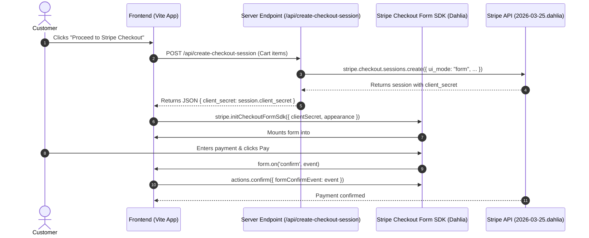

# Stripe Integration TODO

This document is the single source of truth for the remaining setup steps for the Modus 3D Stripe Embedded Checkout integration.

---

## Values to Replace

The following values are placeholders and must be updated before going live.

**Files containing placeholders:**
- [.env](.env)
- [.env.example](.env.example)
- [src/services/checkout.ts](src/services/checkout.ts)

| Field | Current Value | What to Set |
|-------|--------------|-------------|
| `VITE_STRIPE_PUBLISHABLE_KEY` | `pk_test_...` | Your actual Stripe Publishable Key from Dashboard (https://dashboard.stripe.com/test/apikeys). |
| `STRIPE_WEBHOOK_SECRET` | `whsec_...` | Your actual Stripe Webhook Signing Secret from Stripe Workbench (https://dashboard.stripe.com/workbench/webhooks). |

---

## Configured Parameters

These parameters were configured in Checkout Studio and are already set correctly.

**Files containing these parameters:**
- [api/create-checkout-session.ts](api/create-checkout-session.ts)

| Parameter | Value |
|-----------|-------|
| `ui_mode` | `form` |
| `billing_address_collection` | `auto` |
| `phone_number_collection.enabled` | `false` |
| `automatic_tax.enabled` | `false` |
| `submit_type` | `pay` |
| `shipping_address_collection.allowed_countries` | `["US"]` |
| `integration_identifier` | `custom_embedded_web_0001` |

---

## Setup and Next Steps

### 1. Setup Instructions
1. **Environment Variables**:
   Copy `.env.example` to `.env` (never commit `.env` to source control):
   ```bash
   cp .env.example .env
   ```
2. **Environment Variable Naming**:
   - Variables accessible by the browser (Vite frontend) **must** start with `VITE_`:
     - `VITE_STRIPE_PUBLISHABLE_KEY=pk_test_...`
   - Server-only variables (Node.js SDK, serverless endpoints) **must NOT** have the `VITE_` prefix:
     - `STRIPE_SECRET_KEY=sk_test_...`
     - `STRIPE_WEBHOOK_SECRET=whsec_...`
3. **Backend Dependencies**:
   If hosting the serverless endpoints on Node.js/Vercel/Netlify:
   ```bash
   npm install stripe
   ```

---

### 2. Project Structure of Integration Files
- [api/create-checkout-session.ts](api/create-checkout-session.ts): Server-side endpoint creating Stripe Checkout Sessions using API version `2026-03-25.dahlia`, `ui_mode: "form"`, and returning `{ client_secret: session.client_secret }`.
- [api/webhook.ts](api/webhook.ts): Fulfillment webhook handler listening for `checkout.session.completed` to forward orders to 3D print farms.
- [index.html](index.html): Loads Stripe.js directly from `https://js.stripe.com/dahlia/stripe.js` in `<head>` and provides `<div id="checkout-form"></div>`.
- [src/services/checkout.ts](src/services/checkout.ts): Client-side integration using `stripe.initCheckoutFormSdk(...)` with Studio appearance, form mounting, and confirmation event listener.

---

### 3. How the Integration Works (Flow Overview)


1. Customer initiates checkout from the cart drawer.
2. The server endpoint creates a session with `ui_mode: "form"` and returns `{ client_secret: session.client_secret }`.
3. Client-side Stripe.js loads from `https://js.stripe.com/dahlia/stripe.js`.
4. `stripe.initCheckoutFormSdk` receives the `clientSecret` and Studio appearance configuration.
5. The form mounts directly into the container `<div id="checkout-form"></div>`.
6. When the user confirms payment, `loadActionsResult.actions.confirm({ formConfirmEvent: event })` executes and completes the order.

---

### 4. Testing Credit Card Numbers and Test Modes
In Stripe Test Mode:
- **Test Card Number**: `4242 4242 4242 4242`
- **Expiration Date**: Any valid future date (e.g., `12/28`)
- **CVC**: Any 3 digits (e.g., `123`)
- **ZIP Code**: Any 5 digits (e.g., `90210`)

---

### 5. Next Steps
1. Add your publishable key `VITE_STRIPE_PUBLISHABLE_KEY` to `.env`.
2. Configure webhook secret `STRIPE_WEBHOOK_SECRET` in `.env` for production order processing.
3. Test a complete transaction using the test card above.
4. Deploy backend function to your serverless host (Vercel, Netlify, AWS Lambda) or run locally with Node.

---

### 6. Resources
- Stripe Support: https://support.stripe.com
- Stripe Developer MCP: https://docs.stripe.com/mcp
